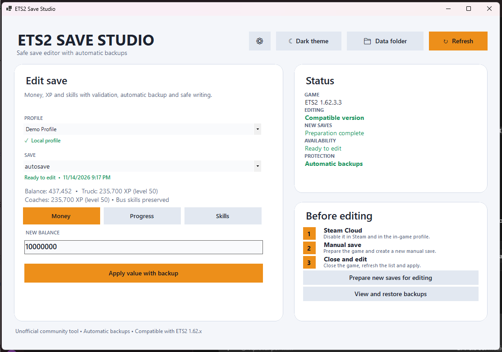

  

<h1 align="center">ETS2 Save Studio</h1>

<strong>Edit your saves. Keep your progress safe.</strong>

  
  
  
  

  <a href="README.pt-BR.md">Português (Brasil)</a> ·
  <a href="CHANGELOG.md">Changelog</a> ·
  <a href="https://github.com/nathan5d/ets2-save-studio/issues">Support and bugs</a>

  
  

> The download links above are prepared for release `v1.0.0-beta.1` and will become active only after that release is published.

## About

ETS2 Save Studio is a free, independent Windows application for editing local Euro Truck Simulator 2 saves. It combines focused money, progression and skill controls with automatic backups, validation and restoration tools.

## Main features

- Load the current balance and set the desired total with a live regional currency preview.
- Edit truck and Coaches progression.
- Configure the six classic truck skills.
- Select a custom ETS2 data folder.
- Use English or Brazilian Portuguese without restarting.
- Switch between light and dark themes.
- View and restore automatic backups from the app.

## Safety and backups

- The previous `game.sii` is backed up before a successful edit.
- Writes use temporary files and post-write validation.
- External file changes are detected before a money edit is committed.
- Restoration preserves the current save before replacing it.
- Editing is blocked while ETS2 is running, when a profile is identified in a Steam Cloud storage location or when the game version is not verified.

These safeguards reduce risk but cannot guarantee protection against every hardware failure, mod incompatibility, third-party change or future game update. Keep independent copies of important saves.

## Compatibility

This beta is verified only for:

- **Euro Truck Simulator 2 1.62.x**
- **Windows 10 or Windows 11, x64**
- Local profiles with Steam Cloud disabled

Editing is intentionally blocked on game versions that have not been explicitly verified.

Steam Cloud profile identification is based primarily on the profile's storage location. ETS2 Save Studio does not query or verify the actual Steam synchronization setting, so users must still confirm that synchronization is disabled in Steam and in the in-game profile.

## Requirements

- 64-bit Windows computer.
- ETS2 closed during editing and restoration.
- Steam Cloud disabled in Steam and in the in-game profile.
- A local save prepared in text format.

Both the installer and portable packages are self-contained. A separate .NET installation is not required.

## Installation

### Installer

1. Download `ETS2-Save-Studio-1.0.0-beta.1-Setup.exe` and its `.sha256` file from the release.
2. Verify the SHA-256 checksum.
3. Run the installer and follow the wizard.

The installer works per user, does not require administrator privileges by default and installs under Local AppData.

### Portable

1. Download `ETS2-Save-Studio-1.0.0-beta.1-win-x64.zip` and its `.sha256` file.
2. Verify the checksum and extract the ZIP to a folder you control.
3. Run `ETS2 Save Studio.exe` from the extracted folder.

Do not run the application directly from inside the ZIP.

## Basic use

1. Disable Steam Cloud in Steam and in the ETS2 profile.
2. Select the ETS2 data folder if it is not under Documents.
3. Choose **Prepare new saves for editing**.
4. Open ETS2, create a new manual save and close the game completely.
5. Refresh ETS2 Save Studio and select the profile and save.
6. Review the detected values and apply the desired change.

The money field represents the desired final balance, not an amount to add.

## Known limitations

- Only ETS2 1.62.x is verified for this beta.
- Binary saves must be prepared and recreated by the game before editing.
- Steam Cloud profiles cannot be edited safely by this release.
- Coaches detection depends on the installed DLC or the manual app setting.
- The app does not purchase, activate or unlock DLCs.
- Mods may change save fields or currency definitions in unsupported ways.

## Support and bug reports

Use [GitHub Issues](https://github.com/nathan5d/ets2-save-studio/issues) for reproducible bugs. Include the app version, ETS2 version, Windows version and the exact error message. Do not upload personal saves, profiles or private paths unless you intentionally choose to share them.

## License

ETS2 Save Studio is free, closed-source freeware. Use and redistribution are governed by:

- [English license](LICENSE.txt)
- [Licença em português](LICENSE.pt-BR.txt)

## Credits

Developed by **Nathan Amaral**.

## Unofficial software notice

ETS2 Save Studio is an independent, unofficial community tool. It is not affiliated with, sponsored, endorsed or maintained by SCS Software, Valve or Steam. Euro Truck Simulator 2 and related names and trademarks belong to their respective owners.
