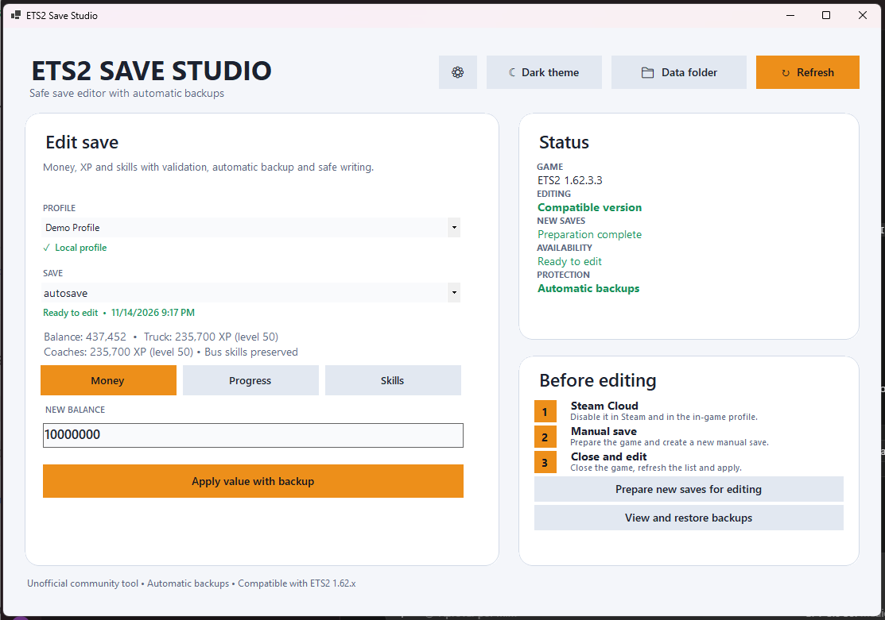

  

<h1 align="center">ETS2 Save Studio</h1>

<strong>Edit your saves. Keep your progress safe.</strong>

  
  
  
  

  <a href="README.md">English</a> ·
  <a href="CHANGELOG.md">Histórico de alterações</a> ·
  <a href="https://github.com/nathan5d/ets2-save-studio/issues">Suporte e bugs</a>

  
  

> Os links acima estão preparados para a versão `v1.0.0-beta.1` e somente funcionarão depois que a Release for publicada.

## Sobre

ETS2 Save Studio é um aplicativo Windows gratuito e independente para editar saves locais do Euro Truck Simulator 2. Ele reúne controles objetivos de dinheiro, progressão e habilidades com backups automáticos, validação e restauração.

## Principais funcionalidades

- Carrega o saldo atual e define o total desejado com prévia monetária regional.
- Edita a progressão de caminhão e Coaches.
- Configura as seis habilidades clássicas de caminhão.
- Permite selecionar uma pasta de dados personalizada do ETS2.
- Alterna entre português brasileiro e inglês sem reiniciar.
- Oferece temas claro e escuro.
- Visualiza e restaura backups automáticos pelo aplicativo.

## Segurança e backups

- O `game.sii` anterior é copiado antes de uma edição bem-sucedida.
- A gravação utiliza arquivos temporários e validação posterior.
- Alterações externas são detectadas antes de confirmar uma edição monetária.
- A restauração preserva o save atual antes de substituí-lo.
- A edição é bloqueada com o ETS2 aberto, quando um perfil é identificado em um local de armazenamento da Steam Cloud ou quando a versão não está homologada.

Essas proteções reduzem riscos, mas não garantem proteção contra toda falha de hardware, incompatibilidade de mods, alteração por terceiros ou atualização futura do jogo. Mantenha cópias independentes dos saves importantes.

## Compatibilidade

Esta beta foi homologada somente para:

- **Euro Truck Simulator 2 1.62.x**
- **Windows 10 ou Windows 11, x64**
- Perfis locais com Steam Cloud desativada

A edição é bloqueada intencionalmente em versões do jogo que não tenham sido homologadas explicitamente.

A identificação de perfis Steam Cloud é baseada principalmente no local em que o perfil está armazenado. O ETS2 Save Studio não consulta nem confirma o estado real da sincronização da Steam; por isso, o usuário ainda deve verificar se ela está desativada no Steam e dentro do perfil do jogo.

## Requisitos

- Computador Windows 64 bits.
- ETS2 fechado durante edições e restaurações.
- Steam Cloud desativada no Steam e dentro do perfil do jogo.
- Save local preparado em formato texto.

Os pacotes instalável e portátil são self-contained. Não é necessário instalar o .NET separadamente.

## Instalação

### Instalador

1. Baixe `ETS2-Save-Studio-1.0.0-beta.1-Setup.exe` e o respectivo `.sha256` na Release.
2. Confira o SHA-256.
3. Execute o instalador e siga o assistente.

O instalador funciona por usuário, não exige privilégios administrativos por padrão e utiliza o Local AppData.

### Portátil

1. Baixe `ETS2-Save-Studio-1.0.0-beta.1-win-x64.zip` e o respectivo `.sha256`.
2. Confira o hash e extraia o ZIP para uma pasta sob seu controle.
3. Execute `ETS2 Save Studio.exe` na pasta extraída.

Não execute o aplicativo diretamente de dentro do ZIP.

## Uso básico

1. Desative a Steam Cloud no Steam e no perfil do ETS2.
2. Selecione a pasta de dados do ETS2 caso ela não esteja em Documentos.
3. Escolha **Preparar novos saves para edição**.
4. Abra o ETS2, crie um novo save manual e feche completamente o jogo.
5. Atualize o ETS2 Save Studio e selecione o perfil e o save.
6. Confira os valores detectados e aplique a alteração desejada.

O campo monetário representa o saldo total final desejado, não um valor a ser somado.

## Limitações conhecidas

- Somente o ETS2 1.62.x está homologado nesta beta.
- Saves binários precisam ser preparados e recriados pelo jogo antes da edição.
- Perfis com Steam Cloud não podem ser editados com segurança nesta versão.
- A detecção de Coaches depende da DLC instalada ou da configuração manual.
- O aplicativo não compra, ativa ou desbloqueia DLCs.
- Mods podem alterar campos ou definições de moeda de formas não reconhecidas.

## Suporte e bugs

Utilize o [GitHub Issues](https://github.com/nathan5d/ets2-save-studio/issues) para relatar problemas reproduzíveis. Informe a versão do aplicativo, do ETS2 e do Windows, além da mensagem de erro exata. Não envie saves, perfis ou caminhos privados, a menos que escolha compartilhá-los conscientemente.

## Licenciamento

ETS2 Save Studio é um freeware gratuito de código-fonte fechado. O uso e a redistribuição são regidos por:

- [Licença em português](LICENSE.pt-BR.txt)
- [English license](LICENSE.txt)

## Créditos

Desenvolvido por **Nathan Amaral**.

## Aviso de software não oficial

ETS2 Save Studio é uma ferramenta comunitária independente e não oficial. Não é afiliada, patrocinada, endossada ou mantida pela SCS Software, Valve ou Steam. Euro Truck Simulator 2, seus nomes e suas marcas pertencem aos respectivos titulares.
